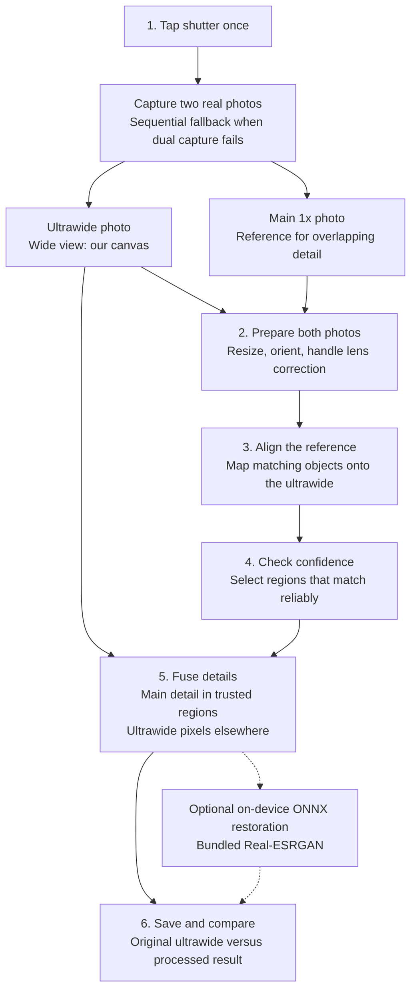

# UW camera

**Project status: Active development**

Native Kotlin Android research prototype intended for phones with ultrawide and main cameras across manufacturers. Pixel 7 is the current test device; compatibility on other devices still requires validation. It captures a real ultrawide frame and a real main-camera reference, aligns their overlap, and transfers detail into the ultrawide canvas. Processing stays on the device. New captures are temporary phone previews; OK archives every stage on the connected laptop through the local USB companion. No network permission, services, accounts, analytics, or runtime model downloads are included. A pretrained restoration model is bundled with the APK.

**Image-quality improvement has not been established.** The connected Pixel 7 exposed ultrawide physical ID 3 and main physical ID 2 behind logical ID 0. Its two 2048×1536 YUV streams configured, but the actual pair request lost the main image buffer. Automatic sequential capture produced completed results. One recorded session had about 1.79 seconds between inputs and about 10% reliable reference coverage; these observations are not quality measurements.

## Captured examples: matched detail and confidence masks

These are real archived captures, compared with their saved **OpenCV fusion + Real-ESRGAN** outputs. The figures use pixel compositing, identical crops, and equal enlargement. No additional exposure, contrast, color, sharpening, or generative edits were applied when making the figures.

The full view has a vertical divider: **original ultrawide on the left, processed output on the right**. Green boxes identify the same **128 x 128 pixel region**, enlarged **4x with nearest-neighbor sampling** on both sides. The confidence overlays appear at the bottom of each figure: green opacity follows the saved reference confidence, with a maximum opacity of 45%.

Crops were deliberately selected to show visible changes within trusted regions. These are illustrative examples, not random benchmark samples. Sharper-looking edges do not establish that recovered detail is accurate, especially for small text and photographed screens. The combined output includes AI restoration; these comparisons do not isolate the benefit of reference fusion alone.

| Scene | Capture date (IST) | Trusted reference area | Changed pixels: fusion | Changed pixels: final | Processing |
| --- | --- | ---: | ---: | ---: | ---: |
| Indoor scene | 25 Oct 2026 | 30.37% | 21.80% | 22.14% | 241.0 s |
| Printed packaging | 25 Oct 2026 | 4.58% | 2.82% | 2.89% | 23.1 s |
| Screen detail | 26 Oct 2026 | 15.38% | 12.27% | 12.73% | 51.8 s |
| Dog figure / very low light | 26 Oct 2026 | 2.51% | 1.47% | 1.53% | 13.5 s |

**What the percentages mean:** trusted reference area comes from the app's saved fusion diagnostics. Changed pixels differ from `prepared-ultrawide.png` by at least 2/255 in any RGB channel across the full image. Fusion values come from the app diagnostics; final values are calculated from the archived final pixels. These are processing-activity percentages, **not percentage improvements in image quality**. No aligned ground truth was supplied, so no PSNR, SSIM, or quality-gain percentage is claimed.

### Indoor scene

The leaf-pattern fabric is the clearest texture example in this set. Inspect the same strands and edges in both crops; the output's crisper appearance alone does not verify detail accuracy.


### Printed packaging

A small trusted region covers the package. Small text can acquire plausible-looking strokes from restoration; the figure should not be interpreted as verified text recovery.


### Photographed screen

The screen image contains display resampling and potential moire. It is a visual processing example, not a clean resolution chart.


### Dog figure: very low light

**This scene was captured in very low light, as reported during capture.** No lux measurement was recorded. Only 2.51% of the canvas had trusted reference support; the enlarged region shows the circular detail on the figure. This is a difficult-condition example, not a measured low-light performance claim. Both sides retain their saved exposure and color.


The [figure manifest](docs/images/comparison-manifest.json) records capture dates, exact crop coordinates, measurements, source SHA-256 checksums and figure checksums. Rebuild from the original local archives with `python tools/compose_readme_comparisons.py` (requires NumPy and Pillow from `desktop/requirements.txt`). The full private photo archives are not included in the repository.

## How it works: the main idea

Keep the ultrawide photo's full view, and borrow main-camera detail only where the two photos match reliably.



The ultrawide is the base photograph. The main camera provides a closer look at part of the same scene. Alignment lines up corresponding objects; confidence checks reject unreliable regions; multiscale fusion blends detail without a rectangular patch. If a region cannot be matched reliably, its original ultrawide pixels are retained. The outer view remains ultrawide. All processing stays on-device.

AI is optional: a bundled Real-ESRGAN model restores the OpenCV-fused image. It is a single-image model, not a learned dual-camera fusion model. Reference coverage and pixel-change statistics indicate processing activity, not proven image-quality gains.

## Open and run

Requirements: Android Studio, JDK 17, Android SDK Platform 35, Build Tools (Gradle can install licensed missing components), and internet access for the initial Gradle dependency download. The checked-in Gradle wrapper uses Gradle 8.14. The app supports API 28+, targets API 35, and uses Camera2 directly.

1. Open this directory as an Android Studio project and allow Gradle sync. Set the local Android SDK location when asked; `local.properties` is machine-specific and ignored by Git.
2. On the Pixel 7, enable Developer options and USB debugging. Connect by USB, unlock the phone, and accept its debugging authorization prompt.
3. Select the Pixel 7 in Android Studio and press Run. Alternatively, from PowerShell with the SDK `platform-tools` on `PATH`:

   ```powershell
   .\gradlew.bat :app:assembleDebug
   adb devices
   adb install -r .\app\build\outputs\apk\debug\app-debug.apk
   adb shell am start -n com.example.referencecamera/.MainActivity
   ```

4. Allow camera access. Close Google Camera or another app if Camera2 reports that the camera is busy.

The app does not need photo-library or storage permission. New inputs and results use app-private temporary cache. Press OK to archive them to the ready laptop, or discard them when disconnected. Older saved sessions retain manual export actions. See the local dashboard instructions below.


### Preview install when the original signing key is unavailable

Build with `./gradlew.bat -PcameraPreview=true :app:assembleDebug` to produce **UW camera** (`com.example.referencecamera.preview`, v0.1.8-preview). It installs alongside the original package and uses separate app-private storage. The default build keeps the original app ID and also uses the UW camera label. Do not uninstall the original app merely to bypass a signing mismatch; that would remove its app-private captures.

## Local laptop admin dashboard

Double-click `Start-Camera-Lab.cmd` to start the USB companion and open `http://127.0.0.1:8765`. It provides live progress, a stage inspector and comparison slider, archives, notes, ZIP/CSV exports, and a ground-truth quality matrix. Read [desktop/README.md](desktop/README.md) for setup, storage, and measurement details.

No image is copied before phone approval. The laptop verifies every file before the phone clears its temporary session. Disconnected OK discards the preview without queuing it. Existing saved captures stay intact.

Use `-PcameraAbi=arm64-v8a` when building for Pixel 7 to omit unused native architectures. This changes device compatibility and APK size, not the model or image processing.

## Capture to result

1. The app lists logical camera IDs, their physical IDs, focal lengths, sensor sizes, YUV/JPEG stream sizes, and advertised concurrent logical-camera sets. It selects two distinct rear lenses using focal length relative to sensor width, preferring a shared logical camera. IDs and zoom ratios are never hardcoded.
2. It opens the logical camera, queries the two selected physical YUV stream configuration where the API implements that query, and attempts to configure that exact session. A successful configure is recorded as evidence for that particular combination of format and sizes. It does not establish support for every stream combination.
3. Press the round shutter **once**. The app attempts dual repeating YUV requests, selecting the two images associated with one capture result. It tries common 4:3 sizes advertised by both physical cameras and the logical camera, using descending size caps of 2048, 1280, and 640 pixels. Both physical metadata entries and sensor timestamps are required. A pair is accepted only if its measured exposure gap is at most 50 ms (an explicit POC threshold, not exact synchronization). The last successful size is preferred for subsequent captures during that app session. Configuration acceptance alone is labeled as unverified delivery.
4. If a pair is unavailable or that capture fails, the app automatically captures ultrawide followed by main. No second shutter tap is required. **SEQUENTIAL** and step-by-step progress make the timing limitation visible. Keep the phone and scene still until both images finish saving. Settings can also force the sequential method. Failed dual delivery is remembered for this strategy, camera routes, and OS build, so restarting does not repeat the slow attempts. Use **Settings → Retry dual-camera detection** to explicitly try again.
5. OpenCV immediately processes both saved images on a worker dispatcher. The app opens the original/result comparison and processing status. New captures remain temporary until OK archives all stages to a ready laptop. **Recent** can also open older persistent sessions; those are never removed by temporary-preview cleanup. The result screen explicitly distinguishes reference fusion, optional ONNX output, and a retained ultrawide when alignment is unreliable.

You do **not** need to import an ONNX model to capture, process, or view the baseline. A pretrained model is bundled, so AI requires no import. Settings includes an AI toggle and optional custom-model import. For new captures, use OK to archive every stage to the laptop. Manual stage and ZIP exports remain available when inspecting older persistent sessions.

Comparison controls offer Fit, 2× and 4× inspection, with dragging when zoomed. The Mask button overlays reference confidence in cyan. Newly processed sessions report reference coverage and pixels changed by at least 2/255 in any channel relative to the prepared ultrawide. These diagnostics measure processing activity, not quality. The baseline and comparison use the same INTER_AREA resize filter. The display loads the saved processing resolution; zoom does not recover extra pixels. Older sessions can be inspected but lack the new metrics and retain their original comparison files.

The v0.1.5 experiment adds a small logical PRIVATE stream alongside the two physical YUV outputs. Its frames are drained and discarded; they cannot substitute for either saved lens input. Actual three-output configuration and delivery are checked when capturing. The preliminary two-output probe does not validate this three-output combination. This follows the logical-plus-physical output structure in the Android multi-camera documentation, but support is device-dependent.

Preview rotation compensates only display rotation because TextureView already handles the sensor orientation. Display changes, including a 180-degree rotation, refresh the preview transform. Input YUV image orientation is handled separately during saving and processing.

The dual-session probe covers two physical cameras behind one logical camera. Separate logical camera concurrency is inventoried but this POC does not implement dual-device capture. Those devices use the explicit sequential path even if they advertise another concurrent combination. Session rejection is a configuration-specific result, not a claim that the hardware can never capture two cameras together.

Physical PRIVATE preview streams are optional in Camera2. If a selected physical preview cannot be configured, the app may show the logical camera's preview with an explicit **LOGICAL PREVIEW / SEE STATUS** label explaining that the preview lens may differ. Still capture always uses the selected physical YUV output; a preview fallback never changes the source of a captured input.

## Baseline and component boundaries

Capture callbacks retain a bounded window of NV21 image copies; JPEG compression runs only for the selected input images, outside the camera callback. Dual capture searches a rolling metadata/image window for an exact match from both physical sensors instead of pinning the first metadata result. Explicit dual retries stop starting new candidate attempts after a 10-second search budget; an in-progress attempt and cleanup can run longer. Remembered delivery failures stay in effect across app updates unless the strategy, OS, or camera routes change, or **Retry dual-camera detection** is selected.

New results display separate capture and processing durations, also recorded in `processing.json`. Capture includes camera setup, settling, any dual attempts, fallback, and input saving. Processing includes preprocessing, alignment, fusion, optional inference, and output saving. Older sessions do not have these duration fields.

| Component | Responsibility |
|---|---|
| `camera/CameraDiscovery.kt` | Camera2 inventory, two distinct lens endpoints, bounded stream sizes, calibration inventory |
| `camera/CameraEngine.kt` | Physical routing, session probe, preview, 3A warmup, pair/sequential capture, frame timestamps, stride-aware YUV conversion |
| `processing/ImagePreprocessor.kt` | Bounded decode/resize, lens correction when safe, rotation, invalid-border mask |
| `alignment/FeatureAligner.kt` | ORB/Hamming ratio matches, RANSAC homography, spatial inlier support, local confidence |
| `alignment/LocalRefiner.kt` | Small optical-flow correction with forward/backward consistency and displacement limits |
| `fusion/MultiscaleFusion.kt` | Four-level Laplacian detail transfer, ultrawide low-frequency base, exact outside-mask preservation |
| `model/ReferenceEnhancer.kt`, `model/ModelTiling.kt` | Bundled weights, tiled CPU inference, reference-model imports, confidence blending, and cancellation |
| `processing/ProcessingPipeline.kt` | Stage orchestration, deterministic baseline, diagnostics, bounded-memory retry |
| `storage/CaptureStore.kt` | Local sessions, metadata, PNG and ZIP export |
| `CameraViewModel.kt`, `MainActivity.kt` | Capture state, lifecycle, permission, progress/errors, Material 3 UI |

The processing canvas is at most **1280 pixels on its longest edge** (960 on an out-of-memory retry), with a reference prepared at up to 1.25 times that edge length. Camera YUV captures prefer a supported 4:3 stream of at most 4.1 MP. The full selected frame is retained; processing reduces resolution without cropping the canvas. If 4:3 is unavailable, the device-selected stream's field of view is used and the size is recorded.

Alignment maps main-camera coordinates into ultrawide coordinates. It requires enough homography inliers and a plausible projected overlap. The mask combines the valid warped region, inlier convex hull, bounded local optical flow with forward/backward consistency, and exposure-normalized local residual rejection. Distance from rejected areas feathers the confidence. Four-level Laplacian transfer adds main-camera detail in that mask and retains the ultrawide low-frequency base. It is not a full-image alpha overlay.

Distortion correction prefers the camera HAL's advertised FAST mode. The **actual result mode** is recorded. No second correction is applied to a HAL-corrected frame. When correction is OFF, OpenCV undistortion is enabled only with five intrinsic parameters, five distortion coefficients, a reported crop, and a compatible stream aspect ratio. Android's coefficient order is converted to OpenCV's order. Undefined remap boundaries retain original pixels and are excluded from fusion. If these conditions are absent, processing leaves distortion as captured and reports that limitation. A calibrated correction may change interior pixel geometry; there is no additional crop or output expansion.

## On-device ONNX enhancement

Version 0.1.7 bundles the authors' **Real-ESRGAN general x4v3** weights, exported to a 4.87 MB float32 ONNX graph without retraining. Source URLs, checkpoint and graph checksums, upstream commit, tensor contract, and license are in `app/src/main/assets/models/model.json`. The BSD 3-Clause notice is included in the APK and visible in Settings. The phone does not fetch weights.

**Settings → Apply AI after OpenCV fusion** controls the optional stage and defaults to enabled. AI runs only with accepted alignment and nonzero confidence. The neural model receives the fused OpenCV image; it does not directly receive the main-camera reference. This is single-image restoration following classical camera fusion. It may synthesize texture, and photographic improvement has not been established.

ONNX Runtime uses two CPU threads. Inference uses 96-pixel core tiles with a 40-pixel halo, covering the model's 34-pixel convolutional receptive-field radius. Context comes from real neighbouring pixels, clipped at image edges. Tiles without trusted-reference pixels are skipped. Native 4× output is clipped to RGB `[0,1]`, area-resized to the original canvas size, and stitched from tile cores. The saved image retains the existing processing resolution and full ultrawide view; it is not a saved 4× photograph.

The model proposal retains baseline pixels outside processed cores. The final AI result blends the proposal against the baseline using confidence and preserves every zero-confidence pixel exactly. Both stages are saved. Inference failure retains the baseline; cancellation propagates between tiles. Enhancement duration includes model loading and preparation.

On first use, the asset is copied to app-private `models/realesr-general-x4v3.onnx` and SHA-256 verified. A corrupted cached copy is restored from the asset. Settings can disable AI or remove a custom override to restore the bundled model.

### Reproduce the export and host checks

Use Python 3.12 in a development environment:

```powershell
python -m pip install -r tools/requirements-onnx.txt
python tools/export_onnx_model.py --work work/model-export
```

The exporter verifies the official checkpoint checksum, loads it with `weights_only=True`, recreates its documented topology, and exports opset 17. Checks cover PyTorch/ONNX parity, odd dimensions, tiled/full-frame equivalence, skipped zero-confidence tiles, and preservation outside the mask. Results are in `docs/validation/onnx-host-checks.json`. These checks establish implementation consistency, not image quality.

### Advanced imports

**Settings → Advanced: import custom ONNX model** installs an override at `<app files directory>/models/reference_sr.onnx`. The importer checks the graph and supported tensor contract before replacing the previous override. It accepts a single self-contained file up to 512 MiB; external tensors are unsupported. Runtime dimensions, values, memory, and latency are checked during inference. **Use bundled Real-ESRGAN** removes the override.

The original reference-model contract remains supported:

| Name | Type / shape | Meaning |
|---|---|---|
| `target` | float32 `[1,3,H,W]` | OpenCV baseline, RGB `[0,1]` |
| `reference` | float32 `[1,3,H,W]` | Main frame aligned to the canvas |
| `confidence` | float32 `[1,1,H,W]` | Trusted reference weight `[0,1]` |
| `enhanced` | float32 `[1,3,H,W]` | RGB output at the same canvas size |

Runtime batch is 1; dynamic spatial dimensions are recommended. Compatible single-image exports instead use `image` → `upscaled`, dynamic spatial dimensions, native 4× scale, and the metadata generated by our exporter. Arbitrary downloaded ONNX models require matching adapters; renaming their files is insufficient.

Sources: [authors' repository](https://github.com/xinntao/Real-ESRGAN), [official model release](https://github.com/xinntao/Real-ESRGAN/releases/tag/v0.3.0).

## Files and diagnostics

Each capture session is stored under `files/captures/<time>-<id>/`:

- `ultrawide.jpg`, `main.jpg`: original camera YUV inputs encoded locally as JPEG quality 97, with EXIF orientation. These are not Google Camera HDR+ images or sensor RAW files.
- `capture.json`: logical/physical routes, selected stream sizes, calibration, actual crop/correction/focal-length metadata, capture mode, sensor timestamps, and wall-clock times.
- `pair-attempts.json`: dual repeating-stream sizes attempted, delivery errors, and successful exposure gap. Dual capture can trade resolution for delivery; final input sizes and timing also appear in Processing details. The same-result frame pair is selected using exact image-to-physical-metadata timestamp matching; independent stream frames are not paired by callback arrival order.
- `capture-error.txt`, if capture fails: the stage and exception details. Operational timeouts are shown as errors; lifecycle cancellation is reported as interruption. A timestamp-rejected image is retained for diagnosis before the rejection is reported.
- `comparison-original.png`: oriented, resized ultrawide before optional geometric correction.
- `prepared-ultrawide.png`, `prepared-main.png`: actual resized/oriented/lens-corrected preprocessing outputs.
- `aligned-reference.png`, `confidence.png`: lossless aligned reference and visual confidence mask. Older sessions used `aligned-reference.jpg`.
- `baseline.png`: deterministic OpenCV result, always saved as its own stage.
- `onnx-proposal.png`: model proposal at the processing-canvas size, before confidence blending; baseline pixels remain outside processed cores. Native 4× tensors are not saved.
- `onnx-result.png`: confidence-blended model proposal. Both model stages are saved only on success; a successful baseline-only retry removes stale files.
- `result.png`: final output (ONNX output on success, otherwise the OpenCV baseline). The result screen compares the resized ultrawide against the selected OpenCV, model-proposal, or AI-blended stage. Share stage and Save stage export the stage being viewed. ZIP export keeps captured inputs, current image stages, and diagnostics. Older AI sessions without a standalone ONNX image use their existing final result as the AI stage.
- `processing.json`: alignment acceptance, stage filenames, notes, canvas size, exposure gap, model ID/SHA-256, enhancement duration, and processed-tile count.

`files/camera-report.json` stores the latest discovery/probe report. Partial inputs remain on disk if capture or processing fails. Export the ZIP to preserve inputs, output, and diagnostics. App-private sessions survive closing the app but are removed by clearing app data or uninstalling. **Results** lists completed sessions and opens their comparison and exports after app restart. In-progress capture/processing state is not automatically restored after process death. For debug recovery of partial inputs, `adb shell run-as com.example.referencecamera ls files/captures` can list saved sessions.

One persistent ImageReader listener drains warmup frames and is armed on its own callback thread before the still request. Images are correlated with physical capture-result timestamps in either callback order; API 33+ capture outputs explicitly use the sensor timestamp base. Buffer loss, aborted sequences, and camera-operation timeouts produce explicit errors. This avoids replacing a warmup listener while the still image is being delivered.

## Limitations and evaluation

- Physical camera IDs and stream support depend on the Pixel's OS and Camera2 implementation. This app cannot establish the user's Pixel 7 topology until run there. There is no lens fallback to a crop or digital zoom. If two suitable lenses are hidden, discovery fails visibly.
- A successful pair session does not guarantee zero exposure skew. Sensor timestamp differences are recorded; compare only timestamps from compatible clock domains. The selected logical sensor synchronization type is also reported. Independent cameras, rolling shutter, autofocus, and different exposure/noise processing can cause mismatches.
- Warmup allows automatic exposure/focus to settle with a timeout. Continuous autofocus is enabled when all participating lenses advertise it; otherwise the shared request uses AF OFF and the lens's default focus position. This is especially relevant to a fixed-focus ultrawide paired with the main camera: start with distant scenes, or use sequential capture for independent main-camera autofocus. This POC does not lock exposure, synchronize manual sensor controls, or provide Google Camera multi-frame processing.
- Different viewpoints cause parallax. A global homography plus a small local flow cannot reconstruct disoccluded surfaces or arbitrary nearby objects. Confidence rejection can miss a bad match or reject useful detail. Use a tripod, distant static textured scene, and good lighting initially.
- Field of view is preserved relative to the selected ultrawide Camera2 stream, which may differ from the Google Camera app's proprietary correction/crop. Processing resolution is intentionally below the capture resolution.
- There is no quality-improvement claim. Compare the baseline against the same ultrawide resized with the same filter, inspect alignment/ghosting and the seam, and record latency and timestamp skew. For quantitative claims, collect registered ground truth and report center-region PSNR/SSIM or a validated perceptual metric, plus failure cases across depth, motion, lighting, and texture. A natural-scene visual comparison alone is not a measurement of recovered detail.

## Build and checks

Run connected instrumentation checks on a dedicated test device or emulator. The Gradle test runner can uninstall its target app after the run, which removes app-private captures. Export important sessions before running connected tests on a phone used for photography.

```powershell
.\gradlew.bat :app:assembleDebug :app:lintDebug
.\gradlew.bat :app:testDebugUnitTest
.\gradlew.bat :app:connectedDebugAndroidTest
```

JVM checks cover tile coverage/context bounds, padded/interleaved YUV planes, buffer positions, chroma order, sensor crop offsets, and preview geometry for portrait/landscape/270-degree sensors and a square viewport. Instrumentation checks use synthetic images to check canvas preservation, exact preservation outside zero-confidence regions, detail-band transfer inside a mask, known-crop alignment, rejection of featureless references, and a complete oriented capture-file-to-baseline pipeline with no model. Saved-result tests check reopening, newest-first ordering, incomplete-session exclusion, storage path boundaries, standalone and legacy AI stages, stale-stage rejection, selected-stage exports, and a missing-baseline fallback. Synthetic pipeline tests also cover separate model-stage saving and cleanup on a baseline-only retry; this uses a test double, not trained-model inference. Additional ONNX tests execute the bundled model on a small synthetic image, verify checksums and zero-confidence preservation, exercise reference imports/non-finite rejection, and check disabling/cancellation. Android instrumentation requires an emulator or device and native OpenCV. They do not establish real capture timing or prove photographic quality.

Primary API references: [Camera2 multi-camera](https://developer.android.com/media/camera/camera2/multi-camera), [physical OutputConfiguration routing](https://developer.android.com/reference/android/hardware/camera2/params/OutputConfiguration#setPhysicalCameraId(java.lang.String)), [ONNX Runtime Java](https://onnxruntime.ai/docs/get-started/with-java.html), and [OpenCV](https://docs.opencv.org/4.x/).
