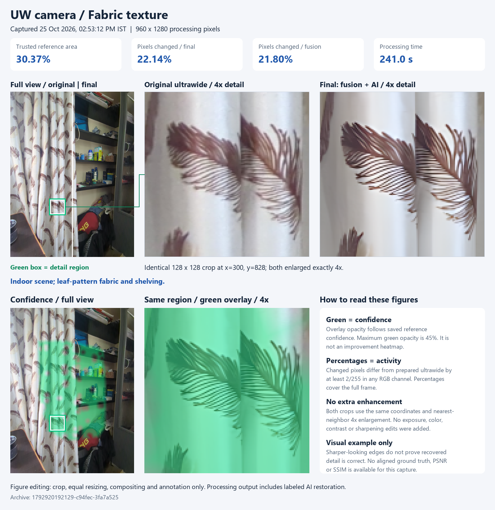
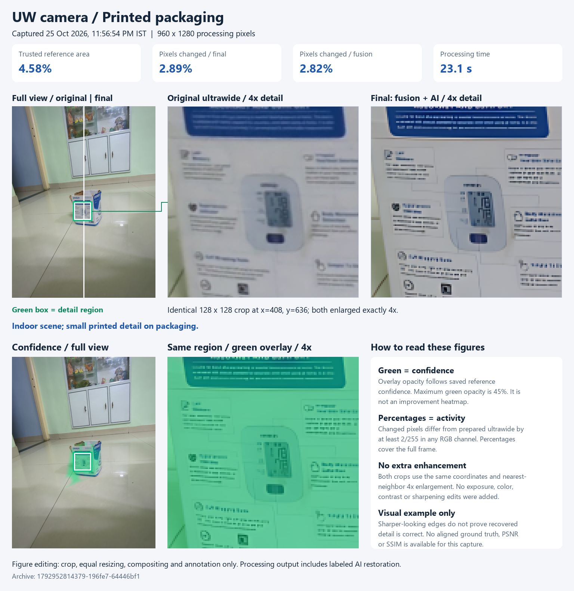
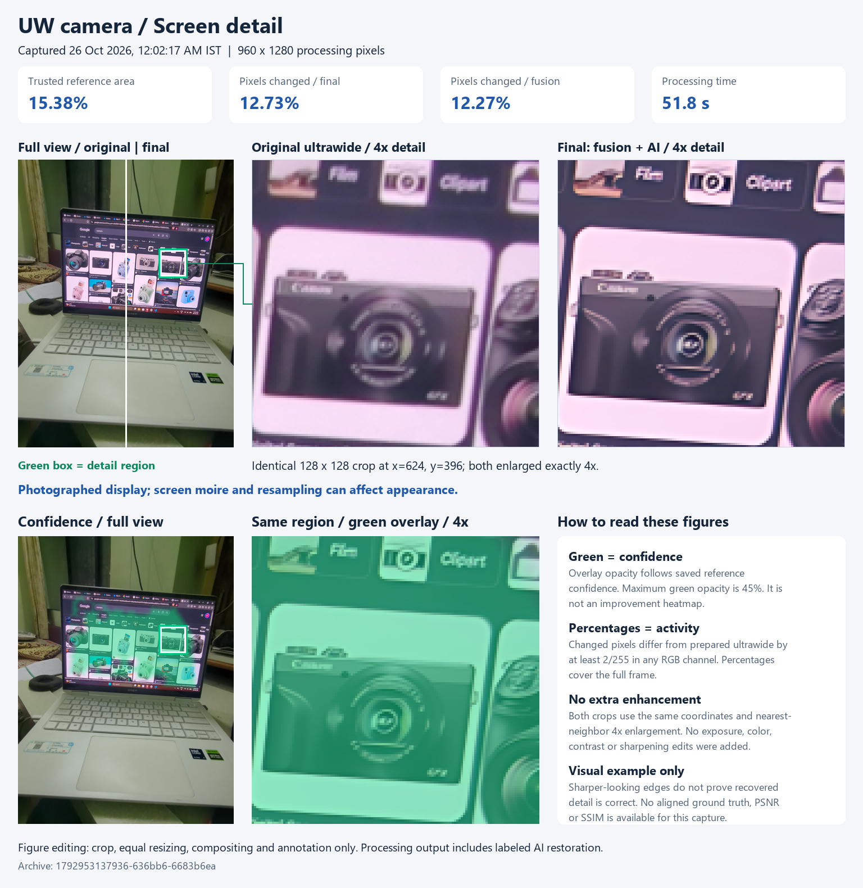
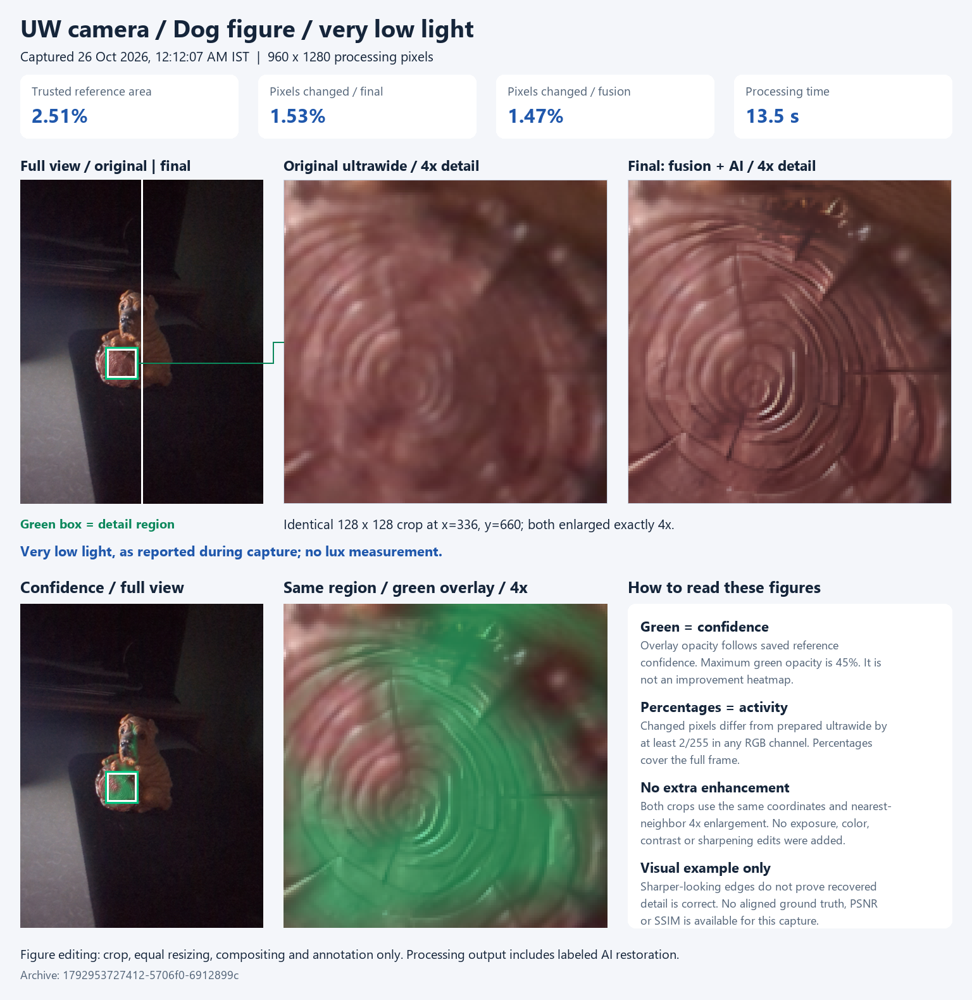

# UW camera

**Project status: Active development**

UW camera combines an ultrawide photo with detail from the main camera. The ultrawide image keeps its field of view, while the main camera contributes detail where the two images line up reliably.

I'm exploring how far this approach can go with on-device processing. The app uses OpenCV for alignment and fusion, with optional Real-ESRGAN restoration through ONNX Runtime. A local laptop dashboard lets me inspect each stage and compare the results.

Pixel 7 is my current test device. The project is intended for phones with ultrawide and main cameras across manufacturers, although other devices still need testing. This is a working research prototype; improvement over a phone's stock camera has not been measured.

## How it works

One shutter press starts the pipeline:

1. Capture an ultrawide image and a main-camera reference.
2. Prepare both images, handling orientation, resolution and lens correction where supported.
3. Align the main image to the ultrawide and build a confidence mask for their overlap.
4. Blend main-camera detail into trusted regions using multiscale fusion.
5. Optionally restore the fused image with Real-ESRGAN and blend its output using the confidence mask.

Pixels outside the supported region stay unchanged from the prepared ultrawide. If alignment is rejected, the app keeps the ultrawide output. The neural model receives the fused image, not the main-camera reference directly. Fusion and AI restoration are separate stages, and their outputs are saved separately.

## Photo examples

These are real captures compared with the combined fusion + AI output. The full view has a central divider: original on the left, processed on the right. Both detail panels show the same 128 x 128 region enlarged 4x. Green overlays at the bottom show reference confidence.

The crops were chosen to make changes visible. Making these figures involved cropping, equal resizing, layout and annotation only. No extra sharpening, exposure adjustments or AI image generation were used to edit the figures. The app's restoration stage is included in the labeled output; these comparisons do not isolate the benefit of fusion alone or prove that every restored detail is correct.

| Scene | Capture date (IST) | Trusted reference area | Changed pixels: fusion | Changed pixels: final | Processing |
| --- | --- | ---: | ---: | ---: | ---: |
| Indoor scene | 25 Oct 2026 | 30.37% | 21.80% | 22.14% | 241.0 s |
| Printed packaging | 25 Oct 2026 | 4.58% | 2.82% | 2.89% | 23.1 s |
| Screen detail | 26 Oct 2026 | 15.38% | 12.27% | 12.73% | 51.8 s |
| Dog figure / very low light | 26 Oct 2026 | 2.51% | 1.47% | 1.53% | 13.5 s |

**Reading the numbers:** trusted reference area comes from the app's saved fusion diagnostics. A pixel counts as changed when any RGB channel differs from the prepared ultrawide by at least 2/255, measured across the full image. Fusion values come from the app; final values are calculated from the archived output. These percentages describe processing activity, not quality gains. No aligned ground truth was supplied for these captures, so PSNR and SSIM are unavailable.

### Indoor scene

The leaf-pattern fabric shows the difference in edge and texture rendering.



### Printed packaging

The package occupies a small part of the frame. Some strokes become more distinct, but small text needs a clean reference before it can be treated as correctly recovered.



### Photographed screen

Display resampling and moire can affect this scene. It is a visual processing example rather than a resolution benchmark.



### Dog figure: very low light

This photo was taken in **very low light**, as reported during capture. No light-level measurement was recorded. Only 2.51% of the image had trusted reference support; the crop shows the circular detail on the figure. Both sides keep their saved exposure and color.



The [comparison manifest](docs/images/comparison-manifest.json) records dates, crop coordinates, measurements and source checksums. Green opacity follows the saved confidence values, up to 45%; it is not an improvement heatmap. The detail crops use nearest-neighbor enlargement to show both sets of saved pixels equally.

Rebuild the figures from the original local archives with `python tools/compose_readme_comparisons.py`, using NumPy and Pillow from `desktop/requirements.txt`. Private capture archives are excluded from the repository.

## Run the app

You'll need Android Studio, JDK 17, Android SDK Platform 35 and a phone exposing suitable cameras through Camera2. The app supports Android 9 / API 28 and later, targets API 35, and uses the Gradle 8.14 wrapper. The initial build downloads dependencies.

Open the project in Android Studio, set the SDK path, enable USB debugging on the phone and allow camera access. You can also build and install from PowerShell with `adb` on your PATH:

```powershell
./gradlew.bat :app:assembleDebug
adb devices
adb install -r ./app/build/outputs/apk/debug/app-debug.apk
adb shell am start -n com.example.referencecamera/.MainActivity
```

For a separate preview installation:

```powershell
./gradlew.bat -PcameraPreview=true :app:assembleDebug
adb install -r ./app/build/outputs/apk/debug/app-debug.apk
adb shell am start -n com.example.referencecamera.preview/com.example.referencecamera.MainActivity
```

Both builds display **UW camera**. The preview package uses separate app storage. Keep any existing installation whose saved captures you need: uninstalling it to resolve a signing mismatch would delete that data.

For an ARM64 phone such as Pixel 7, add `-PcameraAbi=arm64-v8a` to omit unused native libraries. This reduces APK size without changing model weights or image processing, but limits the APK to compatible processors.

## Capture and save

Tap the shutter once and keep the phone and scene still until both captures finish. The app tries dual-camera capture and falls back to ultrawide-then-main sequential capture when needed. The capture method and processing progress appear on screen.

The result screen offers the OpenCV baseline, model proposal and AI-blended output, with Fit, 2x and 4x inspection and a confidence-mask overlay. AI can be disabled in Settings. The model is bundled, so it needs no import or download.

**New captures are temporary.** Connect the laptop companion and press **OK - Save all stages to laptop** to keep a session. The laptop checks every file before the phone clears its temporary copy. A failed transfer leaves the current preview available for retry or discard.

When the laptop is unavailable, OK discards the preview without queuing it. App restart or Android cache cleanup can also remove temporary previews. Older persistent sessions retain their manual export controls.

## Laptop dashboard

The dashboard runs at `http://127.0.0.1:8765`. It provides live progress, archived sessions, stage comparisons, difference views, notes and ZIP/CSV exports.

Follow [desktop/README.md](desktop/README.md) to configure Python and Android platform-tools, then double-click `Start-Camera-Lab.cmd`. Keep the console open while using it; Ctrl+C stops the server. The default companion connects to the preview package.

Only progress metadata reaches the laptop before approval. Approved files go into the Git-ignored `desktop-data/` folder. PSNR and SSIM can be calculated when you supply a clean, already aligned reference with matching dimensions; the main-camera input is not automatically ground truth.

Processing stays on the phone. The Android app requires no internet or photo-library permission. The dashboard listens only on the laptop's loopback address and uses authorized ADB access to the debug app. It is a development companion, not a consumer deployment solution.

## Implementation

| Part | Main files |
| --- | --- |
| Camera discovery and capture | `camera/CameraDiscovery.kt`, `camera/CameraEngine.kt` |
| Image preparation | `processing/ImagePreprocessor.kt` |
| Alignment and local refinement | `alignment/FeatureAligner.kt`, `alignment/LocalRefiner.kt` |
| Detail fusion | `fusion/MultiscaleFusion.kt` |
| ONNX inference | `model/ReferenceEnhancer.kt`, `model/ModelTiling.kt` |
| Pipeline and storage | `processing/ProcessingPipeline.kt`, `storage/CaptureStore.kt` |
| Phone UI and USB handoff | `MainActivity.kt`, `CameraViewModel.kt`, `bridge/LaptopBridge.kt` |
| Local archive and dashboard | `desktop/` |

Camera discovery selects distinct rear lenses without hardcoded IDs or zoom ratios. Capture prefers supported 4:3 streams within a 4.1 MP limit. Dual capture tries shared sizes capped at 2048, 1280 and 640 pixels on the longest edge, matching images to physical-camera metadata. Exposure gaps above 50 ms are rejected; this threshold does not imply exact synchronization.

Processing uses a canvas of at most **1280 pixels on its longest edge**, reduced to 960 on a memory retry. Resizing retains the selected ultrawide stream's full frame. Alignment uses ORB features, a RANSAC homography and bounded local optical flow. Four-level Laplacian fusion transfers detail into trusted regions while retaining the ultrawide low-frequency base.

Lens correction prefers the camera HAL. OpenCV correction is applied only when the recorded calibration supports it, avoiding a second correction of an already corrected image. If physical preview is unsupported, the app may show a labeled logical-camera preview; still captures remain routed to the selected physical lens.

### ONNX model

The bundled **Real-ESRGAN general x4v3** weights were exported without retraining to a roughly 4.87 MB float32 graph. Source URLs, provenance and checksums are in [model.json](app/src/main/assets/models/model.json). The [BSD 3-Clause model notice](app/src/main/assets/models/LICENSE-Real-ESRGAN.txt) is included in the APK and shown in Settings.

ONNX Runtime uses two CPU threads and 96-pixel core tiles with a 40-pixel context halo. Tiles without reference support are skipped. Native 4x predictions are area-resized back to the processing canvas: the saved result is **not a 4x resolution photo**. The model proposal and confidence-blended result are separate files. Inference failure keeps the baseline, and zero-confidence pixels remain unchanged from it.

To reproduce the export and host checks with Python 3.12:

```powershell
python -m pip install -r tools/requirements-onnx.txt
python tools/export_onnx_model.py --work work/model-export
```

The exporter checks the official checkpoint checksum, PyTorch/ONNX parity and tiled inference consistency. Results are in [onnx-host-checks.json](docs/validation/onnx-host-checks.json).

<details>
<summary>Custom ONNX models</summary>

Settings can import a self-contained override up to 512 MiB. Its graph must match a supported contract; arbitrary models will not work just by renaming the file. External tensor files are unsupported. **Use bundled Real-ESRGAN** removes an override.

| Tensor | Type and shape | Contents |
| --- | --- | --- |
| `target` | float32 `[1,3,H,W]` | OpenCV baseline, RGB `[0,1]` |
| `reference` | float32 `[1,3,H,W]` | Aligned main image |
| `confidence` | float32 `[1,1,H,W]` | Reference weights `[0,1]` |
| `enhanced` | float32 `[1,3,H,W]` | Output at canvas size |

Batch size is 1; dynamic spatial dimensions are recommended. Compatible single-image exports use `image` to `upscaled`, native 4x scale and the exporter's metadata. Graph compatibility is checked before an override replaces the previous model.

</details>

### Saved stages

New phone sessions use `cache/pending-captures/<time>-<id>/`. Approved archives go to `desktop-data/sessions/<capture-id>-<manifest-hash>/` on the laptop. Persistent `files/captures/` sessions from earlier versions are retained.

| Files | Contents |
| --- | --- |
| `ultrawide.jpg`, `main.jpg` | Camera2 YUV inputs encoded locally as JPEG with orientation metadata; not sensor RAW or stock-camera HDR+ images |
| `comparison-original.png` | Oriented, resized ultrawide before optional geometric correction |
| `prepared-ultrawide.png`, `prepared-main.png` | Preprocessing outputs |
| `aligned-reference.png`, `confidence.png` | Aligned reference and confidence mask |
| `baseline.png` | OpenCV fusion result |
| `onnx-proposal.png`, `onnx-result.png` | Model proposal and confidence-blended AI result, when inference succeeds |
| `result.png` | Final output, using the baseline if AI is unavailable |
| `capture.json`, `processing.json` | Camera metadata, exposure gap, alignment results, model identity, timings and notes |
| `pair-attempts.json`, `capture-error.txt` | Capture attempts and error diagnostics, when present |
| `transfer-manifest.json` | File sizes and checksums for archival |

## Current limitations

- **Device support:** physical camera access and stream combinations vary by phone and OS. Separate logical-camera concurrency is inventoried but not implemented as dual-device capture.
- **Capture timing:** on the tested Pixel 7, dual streams configured but did not reliably deliver both images. Sequential capture works, but its exposure gap makes moving scenes difficult. Failed dual delivery is remembered; Settings can retry it explicitly.
- **Alignment:** nearby objects, parallax, occlusions and movement can cause bad matches. Confidence checks help, but do not catch every failure.
- **Speed:** the examples took 13.5-241 seconds to process. CPU inference still needs work before this fits a typical camera workflow.
- **Detail accuracy:** restoration can produce convincing but incorrect texture or text. More devices, controlled comparisons, ground truth and failure cases are needed.
- **Stock-camera differences:** Camera2 inputs lack the stock app's full computational pipeline. The exposed stream's correction and field of view may also differ, and the current output resolution is below the capture resolution.

See [VALIDATION.md](VALIDATION.md) for recorded tests and device observations.

## Build and checks

```powershell
./gradlew.bat :app:assembleDebug :app:lintDebug
./gradlew.bat :app:testDebugUnitTest
python -m unittest discover -s desktop/tests -v
```

Run Android instrumentation on a dedicated test device or emulator:

```powershell
./gradlew.bat :app:connectedDebugAndroidTest
```

The connected Gradle runner can uninstall its target app afterward, removing app-private data. Preserve important captures first.

Tests cover capture-buffer handling, preview geometry, alignment, fusion boundaries, ONNX inference, stage storage, cleanup, archive integrity and reference metrics. Synthetic tests check implementation behavior, not photographic quality. The opt-in USB round-trip test is documented in [desktop/README.md](desktop/README.md).

## References

- [Real-ESRGAN](https://github.com/xinntao/Real-ESRGAN) and [official model release](https://github.com/xinntao/Real-ESRGAN/releases/tag/v0.3.0)
- [Android Camera2 multi-camera](https://developer.android.com/media/camera/camera2/multi-camera)
- [ONNX Runtime for Java](https://onnxruntime.ai/docs/get-started/with-java.html)
- [OpenCV](https://docs.opencv.org/4.x/)
